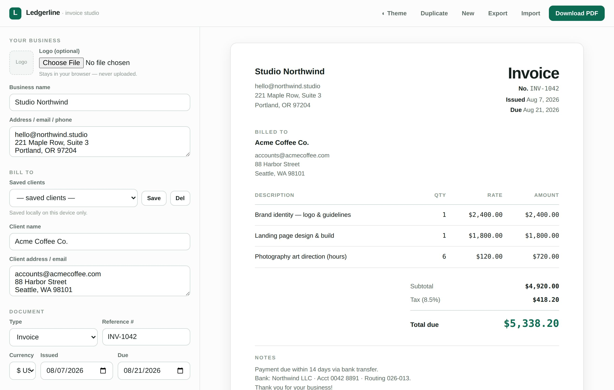

# 🧾 Ledgerline — Invoice Studio

**Privacy-first invoicing that never leaves your browser.**

Create clean, professional invoices in under a minute and export a perfect PDF — with
**no account, no subscription, and nothing uploaded anywhere**. Ledgerline is a single
HTML file that runs entirely on your device. It even works offline.

---

## Features

- 🔒 **Truly private** — every calculation happens in your browser; no server, no tracking.
- 💳 **Get paid faster** — paste a Stripe / PayPal / bank link and it becomes a *Pay this invoice* button on the PDF.
- 🎨 **Make it yours** — logo upload, 5 accent themes, and Invoice / Quote / Estimate / Receipt modes.
- 👥 **Saved clients** — store regular clients and reload them into any invoice.
- 📄 **Pixel-perfect PDF** — print-tuned layout; the export matches the preview exactly.
- 🌓 **Light & dark**, responsive, keyboard-accessible.
- ∞ **Yours forever** — one file, zero dependencies, no lock-in.

## Run it

Just open `index.html` in any modern browser. That's it — no build step, no install.

## Deploy (free)

It's a static file, so any static host works:

- **Netlify Drop** — drag the folder onto [netlify.com/drop](https://netlify.com/drop)
- **Vercel**, **Cloudflare Pages**, or **GitHub Pages** — point them at this repo

## Files

| File | What it is |
|------|------------|
| `index.html` | The invoice app (the product) |
| `landing.html` | A ready-to-ship marketing/sales page |
| `screenshots/` | Product screenshots (light & dark) |

## Tech

Vanilla HTML/CSS/JS. No frameworks, no dependencies, no network calls. Data persists in
`localStorage` on your device only. PDF export uses the browser's native print engine.

## License

[MIT](LICENSE) — do anything you like, including selling it.
